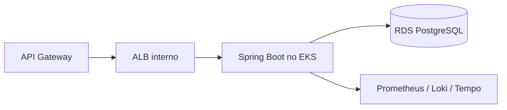

# Oficina Tech Challenge - Sistema de Oficina

> Fase 4 em desenvolvimento: a OS usa inbox e Saga persistida, com outbox e integração local de reserva e execução. O consumidor RabbitMQ é opcional; a fila durável `oficina.os.billing.v1` tem DLQ e a inbox deduplica por `eventId`. O sandbox Mercado Pago e a segurança de produção ainda exigem validação.

No Compose Fase 4, `OFICINA_FASE4_PAYMENT_GATE=true` faz a aprovação aguardar pagamento, sem baixar estoque, e rejeita atualização direta para execução. O coordenador libera a Execução após evento de pagamento e reserva confirmada. Com as integrações desabilitadas, a opção é `false` por compatibilidade com o fluxo legado, que **não tem essa proteção**; não use esse modo para a Fase 4.

Para testar a comunicação local Billing → RabbitMQ → inbox da OS, com os repositórios irmãos ao lado deste, execute `docker compose -f compose.fase4.yaml up -d --build` e depois `bash scripts/smoke-fase4-billing-os.sh` (requer `curl`, `jq`, `uuidgen` e Docker). A configuração usa senhas de teste, portas restritas a localhost e volumes próprios. A OS inicia antes do publicador para declarar sua fila; em uma implantação real a topologia durável deve ser provisionada antes da publicação. O smoke insere dados sintéticos nos volumes. Para parar os containers preservando os dados, use `docker compose -f compose.fase4.yaml stop`. A configuração não representa fluxo completo nem segurança de produção.

O mesmo Compose inicia o serviço de Execução em `127.0.0.1:18082` com MongoDB próprio, disponível apenas na rede interna. Defina `EXECUTION_SERVICE_TOKEN` e `BILLING_SERVICE_TOKEN` no ambiente com pelo menos 32 caracteres cada; chamadas diretas às respectivas APIs devem enviar o token correto no cabeçalho `X-Service-Token`. Quando habilitada, a OS registra a criação em uma outbox e tenta enviá-la à Execução por HTTP; o Compose usa uma filial fixa exclusivamente para teste. A autenticação compartilhada não oferece autorização por filial nem transporte criptografado; MongoDB local não é autenticado.

A OS consulta periodicamente a Execução para receber a conclusão depois do diagnóstico. Respostas com filial ou OS divergentes são recusadas; `COMPLETED` finaliza somente uma OS que já esteja em execução, com registro no histórico e reaplicação idempotente. No modo integrado, a finalização direta pela API da OS é bloqueada.

Novas solicitações de orçamento integrado enviam os itens congelados ao Billing e guardam o mesmo snapshot na outbox; solicitações antigas sem itens continuam usando o contrato anterior. Após confirmação de pagamento, a Saga confere os itens, reserva as peças, autoriza e inicia o reparo. A Execução consome a mesma reserva; reversões antes do início cancelam a autorização, e após o início exigem intervenção. Falta de estoque confirmada cria um pedido financeiro persistido; o estorno depende de confirmação no provedor. Orçamentos antigos sem snapshot exigem reconciliação e os itens ainda vêm do catálogo legado da OS.

O script `scripts/smoke-fase4-saga-sintetica.sh` demonstrou abertura, diagnóstico, orçamento, aprovação, reserva, execução e finalização nos três serviços em Compose isolado, com uma peça cujo estoque passou de cinco para três. **O evento de pagamento é inserido diretamente no banco de teste**, sem chamada ao Mercado Pago. O script exige `DEMO_ALLOW_SYNTHETIC_PAYMENT=1` e o projeto Compose específico `fiap-saga-demo-5921`. Não o use em bancos com dados reais.

A consulta de cliente pela Lambda pode usar `POST /internal/auth/client-lookup`, habilitada por `OFICINA_INTERNAL_AUTH_ENABLED=true` e protegida por `OFICINA_INTERNAL_AUTH_SERVICE_TOKEN` com pelo menos 32 caracteres. Configure o mesmo token na Lambda e exponha a rota somente por rede interna com HTTPS. A substituição está implementada no código, mas ainda precisa ser implantada e validada entre os dois serviços; não exponha esse endpoint publicamente.

Para criar o primeiro administrador em um banco local vazio, configure também `BOOTSTRAP_ADMIN_USERNAME` e `BOOTSTRAP_ADMIN_PASSWORD` no ambiente antes de subir o Compose. Não use credenciais reais no laboratório nem as versione.

O script `scripts/smoke-fase4-diagnostico.sh` testa abertura autenticada, recuperação de indisponibilidade da Execução e retorno de diagnóstico. Ele atua no projeto Compose isolado `oficina-fase4-e2e`, precisa das variáveis de token e bootstrap acima e requer que esse projeto seja iniciado primeiro com `docker compose -p oficina-fase4-e2e -f compose.fase4.yaml up -d --build`. O script para e reinicia a Execução e grava dados sintéticos; use somente nesse ambiente de teste.

Existe também um dispatcher experimental de orçamento, desabilitado por padrão (`oficina.billing-quote.enabled`), que grava o valor total e IDs na outbox antes de chamar Billing. Ele requer `oficina.billing-quote.service-token` e gate de pagamento habilitado. O teste local `scripts/smoke-fase4-orcamento.sh` cobre a criação no Billing real e aprovação até `AGUARDANDO_PAGAMENTO`, com `OFICINA_BILLING_QUOTE_ENABLED=true` no projeto Compose isolado `oficina-fase4-e2e`. Usa filial fixa e não transmite itens. Não habilite fora de um laboratório isolado. Aprovação ainda não comprova pagamento.

Backend para gestao operacional de uma oficina mecanica, desenvolvido para o Tech Challenge FIAP 14SOAT. O projeto evolui o MVP das Fases 1 e 2 e inclui a Fase 3 com migrations, métricas Prometheus, correlação de requisições e segurança por papel/CPF. A arquitetura dos quatro repositórios foi implantada e validada no AWS Academy Learner Lab em 23/10/2026; os recursos cloud são temporários e não constituem URLs permanentes. Consulte a [evidência técnica e o estado da entrega](architecture/fase3-aws.md#execução-validada-no-learner-lab).

> Este repositório ainda inclui laboratório local de Docker/Kubernetes. Não confunda esse laboratório com a implantação gerenciada exigida na Fase 3.

## Proposito

O sistema centraliza o ciclo de atendimento de uma oficina: cadastro de cliente e veiculo, abertura da ordem de servico, diagnostico, composicao de orcamento, aprovacao ou recusa, baixa de estoque, execucao, finalizacao e entrega do veiculo.

O objetivo tecnico e demonstrar uma aplicacao Spring Boot com dominio rico, regras de negocio protegidas nas entidades, API REST documentada, testes automatizados e infraestrutura reproduzivel para execucao local ou em Kubernetes.

## Arquitetura

A aplicacao e um monolito modular orientado a DDD. As responsabilidades estao separadas por camadas:

```text
src/main/java/com/oficina/tech_challenge/
|-- domain/
|   |-- entities/        Entidades e regras de negocio
|   |-- valueobjects/    Objetos de valor como CPF/CNPJ e valores monetarios
|   `-- repositories/    Contratos de persistencia
|-- application/
|   |-- services/        Casos de uso e orquestracao transacional
|   |-- dtos/            Dados de entrada e saida da aplicacao
|   `-- interfaces/      Contratos de servicos
|-- presentation/
|   |-- controllers/     Endpoints REST
|   |-- dtos/            DTOs da API
|   `-- handlers/        Tratamento padronizado de erros
`-- infrastructure/
    `-- security/        JWT, filtros e configuracao de seguranca
```

Fluxo principal:

```text
Cliente/API -> Controller -> Application Service -> Domain Entity/Value Object -> Repository -> PostgreSQL
```

Ponto arquitetural importante: as entidades de dominio ainda usam anotacoes JPA. Em Clean Architecture/Hexagonal estrita, dominio e modelo de persistencia seriam separados. Nesta entrega academica, a decisao foi manter esse acoplamento controlado para preservar escopo e reduzir risco; a separação permanece dívida técnica.

## Funcionalidades

- Autenticacao JWT para rotas administrativas.
- Consulta de OS pelo cliente autenticado via CPF, restrita ao próprio documento.
- Abertura completa de OS com cliente, veiculo, servicos e pecas no mesmo payload.
- Fluxo de status protegido pela entidade `OrdemServico`.
- Geracao de orcamento e baixa de estoque ao aprovar.
- Webhook externo para aprovacao ou recusa de orcamento com idempotencia.
- Listagem operacional de ordens por prioridade.
- Monitoramento de tempo medio e totais.
- Validacao de CPF/CNPJ com digito verificador.
- Aceite de placa brasileira antiga e Mercosul, com normalizacao.
- Swagger/OpenAPI, Postman collection, Docker Compose, Kubernetes, Terraform e GitHub Actions.

## Stack

- Java 17
- Spring Boot 3.3.4
- Spring Data JPA / Hibernate
- Spring Security + JWT
- PostgreSQL 15
- Maven Wrapper
- JUnit 5 + JaCoCo
- Docker e Docker Compose
- Kubernetes manifests
- Terraform com provider Kubernetes

## Pre-requisitos

Para executar com Docker:

- Docker 20.10+
- Docker Compose v2+
- `curl`

Para desenvolvimento local sem container da aplicacao:

- Java 17+
- Maven 3.9+ ou `./mvnw`
- PostgreSQL 15+ ou container PostgreSQL

Para Kubernetes/Terraform:

- `kubectl`
- Um cluster Kubernetes local ou remoto, como minikube, kind, Docker Desktop, EKS ou outro
- `terraform`

## Inicio rapido

O caminho recomendado e usar o script:

```bash
./start.sh
```

O script:

1. verifica Docker, Docker Compose e `curl`;
2. cria `.env` a partir de `.env.example`, se ainda nao existir;
3. sobe PostgreSQL e API com `docker compose up -d --build`;
4. espera o healthcheck da API em `/actuator/health`;
5. imprime os links e comandos uteis.

URLs apos subir:

- API: `http://localhost:8080`
- Swagger: `http://localhost:8080/swagger-ui.html`
- OpenAPI: `http://localhost:8080/v3/api-docs`
- Health: `http://localhost:8080/actuator/health`
- PostgreSQL: `localhost:5432`

Opcoes do script:

```bash
./start.sh              # sobe com build e aguarda healthcheck
./start.sh --no-build   # sobe sem rebuild da imagem
./start.sh --clean      # remove containers e volumes antes de subir
./start.sh --logs       # abre logs da API ao final
./start.sh --help       # mostra ajuda
```

Execucao manual equivalente:

```bash
cp .env.example .env
docker compose up -d --build
docker compose ps
curl http://localhost:8080/actuator/health
```

Para parar:

```bash
docker compose down
```

Para parar e remover o banco local:

```bash
docker compose down -v
```

## Variaveis de ambiente

O `.env.example` contém apenas placeholders que devem ser substituídos localmente:

```env
SECURITY_JWT_SECRET=substitua-por-um-segredo-local-com-no-minimo-32-caracteres
EXTERNAL_WEBHOOK_SECRET=substitua-por-um-segredo-local-para-webhooks
APP_ENVIRONMENT=local
JAVA_OPTS=-XX:+UseG1GC -XX:MaxRAMPercentage=75.0
```

Os valores no arquivo de exemplo são apenas placeholders. Defina secrets locais fortes antes de subir a aplicação; eles não devem ser versionados.

## Observabilidade local

- Health: `GET /actuator/health`
- Métricas Prometheus: `GET /actuator/prometheus`
- Correlação: envie `X-Correlation-Id`; a API o devolve na resposta. Se ausente, a API gera um UUID.
- Logs: saída JSON com serviço, ambiente e `correlationId`; traces OTLP são enviados ao endpoint configurado em `OTEL_EXPORTER_OTLP_ENDPOINT`.

As métricas podem ser coletadas por Prometheus/Grafana locais. Esta configuração não representa o deploy em nuvem exigido na Fase 3.

## Autenticacao

As rotas administrativas exigem JWT com papel `ADMIN`. O JWT de CPF com papel `CLIENTE` permite consultar apenas as próprias OS por CPF, ID e status. Rotas públicas:

- `POST /api/auth/login`
- `POST /api/ordens-servico/{id}/orcamento/notificacoes`
- Swagger/OpenAPI
- `/actuator/health`

Para criar o primeiro administrador, configure `BOOTSTRAP_ADMIN_USERNAME` e `BOOTSTRAP_ADMIN_PASSWORD` no `.env` local (senha com no mínimo 12 caracteres) antes da primeira inicialização. O bootstrap só executa se a tabela de usuários estiver vazia; remova as duas variáveis após a criação inicial. Não publique esses valores. Administradores autenticados podem registrar outros administradores em `POST /api/auth/register`; a rota não é mais pública.

Criar outro administrador (com token de administrador):

```bash
curl -X POST http://localhost:8080/api/auth/register \
  -H "Authorization: Bearer $TOKEN" \
  -H "Content-Type: application/json" \
  -d '{"username":"outro-admin","password":"senha-forte-individual"}'
```

Fazer login:

```bash
curl -X POST http://localhost:8080/api/auth/login \
  -H "Content-Type: application/json" \
  -d '{"username":"admin","password":"senha123456"}'
```

Usar token:

```bash
TOKEN="cole-o-token-aqui"

curl http://localhost:8080/api/clientes \
  -H "Authorization: Bearer $TOKEN"
```

## Endpoints principais

Autenticacao:

```text
POST /api/auth/register
POST /api/auth/login
```

Clientes e veiculos:

```text
GET    /api/clientes
POST   /api/clientes
GET    /api/clientes/{id}
PUT    /api/clientes/{id}
DELETE /api/clientes/{id}
GET    /api/clientes/{id}/veiculos
POST   /api/clientes/{id}/veiculos
PUT    /api/clientes/{id}/veiculos/{veiculoId}
DELETE /api/clientes/{id}/veiculos/{veiculoId}
```

Servicos:

```text
GET    /api/servicos
POST   /api/servicos
GET    /api/servicos/{id}
PUT    /api/servicos/{id}
DELETE /api/servicos/{id}
```

Pecas:

```text
GET    /api/pecas
POST   /api/pecas
GET    /api/pecas/{id}
PUT    /api/pecas/{id}
DELETE /api/pecas/{id}
PATCH  /api/pecas/{id}/estoque
```

Ordens de servico:

```text
GET    /api/ordens-servico
GET    /api/ordens-servico?operacional=true
POST   /api/ordens-servico
GET    /api/ordens-servico/{id}
GET    /api/ordens-servico/{id}/status
GET    /api/ordens-servico/cliente/{cpfCnpj}
POST   /api/ordens-servico/{id}/itens
PATCH  /api/ordens-servico/{id}/diagnostico
PATCH  /api/ordens-servico/{id}/orcamento
POST   /api/ordens-servico/{id}/orcamento/notificacoes
POST   /api/ordens-servico/{id}/status
PATCH  /api/ordens-servico/{id}/aprovar
PATCH  /api/ordens-servico/{id}/finalizar
PATCH  /api/ordens-servico/{id}/entregar
GET    /api/ordens-servico/monitoramento
```

## Exemplo de teste via API

1. Suba o projeto:

```bash
./start.sh
```

2. Configure o bootstrap do primeiro administrador no `.env`, reinicie a aplicação e obtenha o token:

```bash
TOKEN=$(curl -s -X POST http://localhost:8080/api/auth/login \
  -H "Content-Type: application/json" \
  -d '{"username":"admin","password":"SUA_SENHA_FORTE"}' \
  | sed -n 's/.*"token":"\([^"]*\)".*/\1/p')
```

3. Cadastre um servico:

```bash
SERVICO_ID=$(curl -s -X POST http://localhost:8080/api/servicos \
  -H "Authorization: Bearer $TOKEN" \
  -H "Content-Type: application/json" \
  -d '{"nome":"Troca de oleo","descricao":"Troca de oleo do motor","preco":180.00}' \
  | sed -n 's/.*"id":"\([^"]*\)".*/\1/p')
```

4. Cadastre uma peca:

```bash
PECA_ID=$(curl -s -X POST http://localhost:8080/api/pecas \
  -H "Authorization: Bearer $TOKEN" \
  -H "Content-Type: application/json" \
  -d '{"nome":"Filtro de oleo","descricao":"Filtro de oleo do motor","preco":45.00,"quantidadeEstoque":10}' \
  | sed -n 's/.*"id":"\([^"]*\)".*/\1/p')
```

5. Abra uma OS completa:

```bash
OS_ID=$(curl -s -X POST http://localhost:8080/api/ordens-servico \
  -H "Authorization: Bearer $TOKEN" \
  -H "Content-Type: application/json" \
  -d "{
    \"cliente\": {
      \"nome\": \"Maria Cliente\",
      \"cpfCnpj\": \"98765432100\",
      \"telefone\": \"11999999999\"
    },
    \"veiculo\": {
      \"placa\": \"ABC-1234\",
      \"marca\": \"Fiat\",
      \"modelo\": \"Uno\",
      \"ano\": 2020
    },
    \"servicos\": [{ \"servicoId\": \"$SERVICO_ID\" }],
    \"pecas\": [{ \"pecaId\": \"$PECA_ID\", \"quantidade\": 1 }]
  }" | sed -n 's/.*"id":"\([^"]*\)".*/\1/p')
```

6. Consulte status:

```bash
curl http://localhost:8080/api/ordens-servico/$OS_ID/status \
  -H "Authorization: Bearer $TOKEN"
```

7. Simule notificacao externa de aprovacao:

```bash
curl -X POST http://localhost:8080/api/ordens-servico/$OS_ID/orcamento/notificacoes \
  -H "Content-Type: application/json" \
  -H "X-Webhook-Secret: dev-webhook-secret-change-me" \
  -d '{
    "decisao": "APROVADO",
    "origem": "sistema-externo",
    "dataHora": "2026-06-17T10:00:00",
    "identificadorExterno": "ext-001"
  }'
```

A collection da Fase 2 permanece apenas na pasta local `docs/`, ignorada pelo Git. A [collection pública da Fase 3](postman/oficina-fase3.postman_collection.json) está versionada em `postman/` e inclui as variáveis de ambiente sem credenciais reais.

## Testes automatizados

Rodar suite completa com verificacao de cobertura:

```bash
./mvnw verify
```

`HistoricoStatusPostgresIntegrationTest` executa a abertura e uma transição de OS em PostgreSQL real via Testcontainers e verifica que os eventos de histórico são gravados com `ordem_servico_id` obrigatório. O relacionamento é bidirecional: cada evento recebe a OS proprietária antes da persistência em cascata. Esse teste protege a compatibilidade entre JPA e a migration V3; testes apenas com H2 não detectaram a falha anterior.

Rodar apenas testes:

```bash
./mvnw test
```

Relatorio JaCoCo:

```bash
xdg-open target/site/jacoco/index.html
```

Os testes de regras e endpoints usam H2; `FlywayPostgresIntegrationTest` também executa migrations contra PostgreSQL 15 real via Testcontainers 1.21.4 quando Docker está disponível. O build de CI deve manter Docker ativo para que essa prova não seja ignorada.

## Docker

O `Dockerfile` e multi-stage:

- build com `maven:3.9.6-eclipse-temurin-17`;
- runtime com `eclipse-temurin:17-jre-alpine`;
- usuario nao-root `oficina`;
- healthcheck em `/actuator/health`;
- `JAVA_OPTS` configuravel.

Comandos uteis:

```bash
docker compose ps
docker compose logs -f app
docker compose logs -f db
docker compose down
docker build -t oficina-tech-challenge:test .
```

## Kubernetes

Os manifests ficam em `k8s/`.

Crie antes um arquivo local `.env.k8s` (ignorado pelo Git) com `POSTGRES_PASSWORD`, `SPRING_DATASOURCE_PASSWORD`, `SECURITY_JWT_SECRET`, `EXTERNAL_WEBHOOK_SECRET` e, para o primeiro start, `BOOTSTRAP_ADMIN_USERNAME`/`BOOTSTRAP_ADMIN_PASSWORD`. A senha do PostgreSQL deve ser igual nas duas primeiras variáveis. Não existe mais Secret YAML com valores fixos no repositório.

Aplicar em um cluster local ja configurado no `kubectl`:

```bash
kubectl apply -f k8s/00-namespace.yaml
kubectl create secret generic oficina-secret --from-env-file=.env.k8s -n oficina
kubectl apply -f k8s/
kubectl get pods -n oficina
kubectl get svc -n oficina
kubectl port-forward svc/oficina-api 8080:8080 -n oficina
```

Testar:

```bash
curl http://localhost:8080/actuator/health
```

O HPA depende do Metrics Server. Em minikube:

```bash
minikube addons enable metrics-server
```

## Terraform

O Terraform em `infra/` usa o provider Kubernetes. Ele nao cria uma conta AWS nem cria um cluster por conta propria; ele aplica recursos Kubernetes no cluster apontado pelo seu `kubeconfig`.

Para usar localmente:

```bash
cd infra
terraform init
terraform plan \
  -var='jwt_secret=troque-este-jwt-secret' \
  -var='webhook_secret=troque-este-webhook-secret' \
  -var='postgres_password=troque-esta-senha'
terraform apply \
  -var='jwt_secret=troque-este-jwt-secret' \
  -var='webhook_secret=troque-este-webhook-secret' \
  -var='postgres_password=troque-esta-senha'
```

Para AWS, os manifests de `k8s-cloud/` separam `oficina-homolog` e `oficina-prod`; `k8s/` e `infra/` continuam exclusivamente locais. O deploy cloud usa EKS, ECR, ALB, RDS e gateway dos três repositórios de infraestrutura. Ambos os overlays foram aplicados e testados no Learner Lab em 23/10/2026; a infraestrutura é efêmera para preservar o saldo do laboratório.

## CI/CD

O workflow `.github/workflows/ci-cd.yml` executa `./mvnw verify` e valida os overlays em PR. O job cloud só é habilitado por `ENABLE_CLOUD_DEPLOY=true`: usa credenciais temporárias no GitHub Environment `homolog`/`prod`, publica imagem por SHA no ECR, injeta configuração/segredos, faz rollout no EKS e testa a negativa de acesso anônimo pelo gateway. O deploy usa runner próprio rotulado `oficina-deploy`, localizado em um CIDR permitido pelo endpoint restrito do EKS; runners públicos do GitHub não têm IP fixo. Configure proteção de `main` e aprovação do environment `prod` antes de habilitar. No primeiro deploy, antes de existir o Gateway, execute `workflow_dispatch` com `bootstrap_without_gateway=true`: ele faz o rollout da API, mas **pula somente o smoke test do Gateway**. Após criar o Gateway, execute o workflow novamente com o padrão `false` para validar as rotas; não use o bootstrap como evidência final de E2E. Os [runs de produção](https://github.com/ElizeuVicente/fiap-tech-challenge/actions/runs/40000469037) e [homologação](https://github.com/ElizeuVicente/fiap-tech-challenge/actions/runs/40000503924) passaram com o Gateway real. Em nova sessão, configure novamente `GATEWAY_URL`, segredos temporários e runner; os valores anteriores não garantem endpoint ativo.

## Documentacao complementar

- Infraestrutura: `infra/README.md`
- Analise de vulnerabilidades: `ANALISE_VULNERABILIDADES.md`
- [Arquitetura AWS da Fase 3](architecture/fase3-aws.md), com diagramas, RFC, ADR e modelo relacional.
- [Collection Postman da Fase 3](postman/oficina-fase3.postman_collection.json), com `baseUrl` e `prefix` por ambiente; não contém segredos.
- Swagger local: `http://localhost:8080/swagger-ui.html`; na nuvem, acesse por port-forward ao serviço interno quando os recursos estiverem ativos.



  
## Troubleshooting

Porta 8080 ocupada:

```bash
lsof -i :8080
docker compose down
```

Banco indisponivel:

```bash
docker compose ps
docker compose logs db
```

API nao sobe:

```bash
docker compose logs -f app
curl http://localhost:8080/actuator/health
```

Token JWT invalido:

- confirme que o header e `Authorization: Bearer <token>`;
- gere novo token em `/api/auth/login`;
- verifique se o `.env` tem `SECURITY_JWT_SECRET`.
# Catálogo externo experimental — Fase 4

No Compose de Fase 4, `OFICINA_EXECUTION_CATALOG_ENABLED=true` habilita a consulta de peças e serviços por filial ao catálogo da Execução. O padrão é `false`; antes de ativar é necessário migrar e reconciliar dados e estoque. Itens novos congelam ID, descrição e preço; ordens antigas preservam seus valores. A filial ainda é configurada estaticamente. O script `scripts/smoke-fase4-saga-sintetica.sh` prepara os catálogos quando a flag está ativa e usa pagamento simulado, não um pagamento Mercado Pago.

# Restrição local de filiais da Execução

O Compose integrado repassa `EXECUTION_ALLOWED_BRANCHES`, uma lista opcional de UUIDs separados por vírgula. Vazia, a lista não restringe filiais; preenchida, limita as rotas internas da Execução, mas não substitui TLS nem autorização individual.

# Restrição local de filiais do Billing

O Compose integrado repassa `BILLING_ALLOWED_BRANCHES`, opcional e vazio por padrão, para limitar a credencial compartilhada do Billing. Essa lista não substitui TLS ou autenticação individual.

# Proteção experimental por filial

`OFICINA_BRANCH_ACCESS_ENABLED=true` exige vínculo explícito usuário-filial para operações administrativas sobre OS. A listagem retorna apenas ordens das filiais autorizadas e omite ordens sem filial; as rotas administrativas legadas de clientes, peças e serviços continuam bloqueadas, pois não possuem isolamento por filial. A configuração é desabilitada por padrão e não substitui a gestão auditada de vínculos nem uma revisão de todas as integrações.

O script operacional `scripts/gerenciar-vinculo-filial.sh grant|revoke usuario filial-uuid operador motivo` altera vínculos em transação no PostgreSQL configurado via variáveis padrão `PG*` ou `.pgpass`. O banco registra o usuário de banco, o operador declarado e o motivo; o operador declarado não é identidade autenticada. A credencial operacional deve ser restrita, e este procedimento não é uma API de administração nem uma solução completa de autorização.

# Exigência opcional de HTTPS interno

`OFICINA_INTERNAL_TLS_REQUIRED=true` impede a OS de iniciar com URLs HTTP para integrações habilitadas de Billing ou Execução. O Compose local mantém o padrão `false`. Essa verificação não provisiona certificados, não configura mTLS e não protege por si só RabbitMQ ou conexões de banco; o ambiente de implantação deve fornecer TLS e validar certificados confiáveis.

## Preparação do deploy integrado da Fase 4

Os manifests cloud da OS aceitam opcionalmente o Secret Kubernetes `oficina-fase4-config`, além de `oficina-cloud-config` e `oficina-cloud-secret`. Para a demonstração integrada, crie esse Secret no mesmo namespace da OS por um mecanismo seguro fora do Git e configure nele as variáveis de integração descritas no `compose.fase4.yaml`: URLs dos serviços, tokens internos, endereço e credenciais RabbitMQ, IDs de filial e flags do consumidor, publicação de comandos, orçamento, estoque, execução e proteção de pagamento. Ajuste os hosts para os Services Kubernetes; por exemplo, no mesmo namespace, Billing usa `http://oficina-billing:8081` e Execução usa `http://oficina-execution:8082`. Configure os tokens correspondentes também nos respectivos serviços.

Antes de habilitar essas integrações, configure os três bancos separados, RabbitMQ, MongoDB com replica set para reservas, migrações e conectividade; migre e reconcilie o catálogo se ativar o catálogo externo. O arquivo Compose usa valores exclusivamente locais e não deve ser copiado para produção. Restrinja rede e credenciais e configure comunicação segura: os tokens compartilhados não substituem identidade individual ou TLS. Confirme que o Secret existe e que as flags estão habilitadas; o Secret opcional ausente mantém o modo legado, sem comprovar a Fase 4.

O workflow exige um runner self-hosted acessível ao EKS, variáveis e segredos do ambiente GitHub, imagem ECR e sessão AWS válida. Billing e Execução têm deploys próprios com seus respectivos Secrets e imagem GHCR; os namespaces e a acessibilidade das imagens devem corresponder ao cluster escolhido. `kubectl kustomize k8s-cloud/prod` e `kubectl kustomize k8s-cloud/homolog` verificam apenas a renderização, sem validar dependências ou comprovar implantação. A análise CodeQL roda no CI e o relatório JaCoCo é publicado como artefato; `mvn verify` exige pelo menos 80% de linhas no conjunto do serviço. A execução local limpa de 17/11/2026 registrou 1316/1643 linhas (80,10%). Deploy e integração na nuvem dependem de execução e validação no ambiente real.

No Learner Lab, o job de deploy usa runner self-hosted `oficina-deploy` com AWS CLI e perfil `fiap-lab` renovado na máquina do runner; não é necessário cadastrar chaves temporárias no GitHub. Para exigir a configuração integrada antes do rollout, defina `REQUIRE_FASE4_CONFIG=true`: o job verificará a existência do Secret no namespace, mas os valores e a comunicação ainda exigem validação operacional. O runner deve permanecer ligado e com acesso restrito ao endpoint do EKS.
