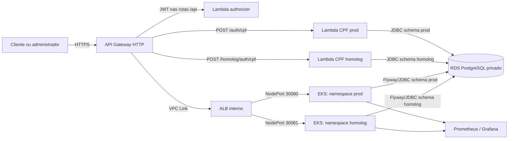
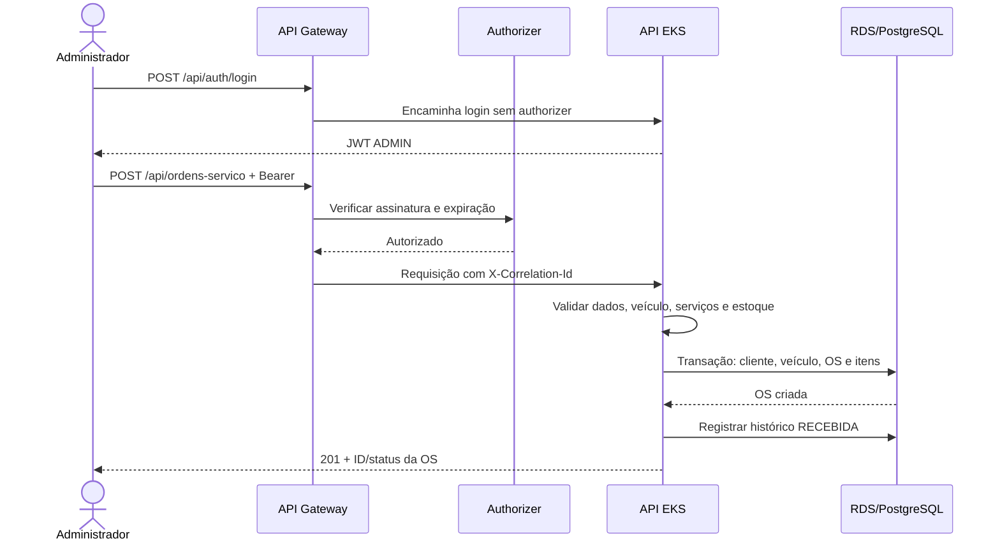
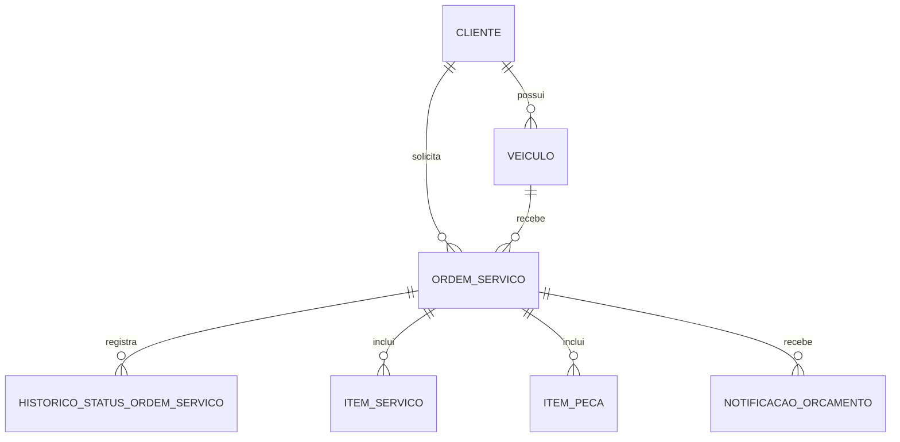

# Arquitetura da Fase 3 — AWS Academy

Estado: **implementação declarativa local, ainda não implantada**. Este documento descreve o desenho versionável; não é evidência de recursos AWS ativos.

## Componentes



## Abertura de ordem de serviço



Um único cluster, ALB e RDS reduzem custo para a janela do laboratório. O isolamento entre ambientes é lógico: namespaces e schemas distintos. Isso **não** equivale ao isolamento forte de contas/VPCs/bancos independentes. O cluster usa nós públicos para evitar NAT Gateway, sem SSH; RDS e ALB ficam privados. O gateway é a única entrada pública da aplicação. O endpoint administrativo do EKS fica limitado por CIDR. O runner de deploy precisa estar nesse CIDR.

## Autenticação e autorização

```mermaid
sequenceDiagram
  actor Cliente
  participant G as API Gateway
  participant L as Lambda CPF
  participant DB as RDS
  participant AZ as Authorizer JWT
  participant API as API EKS
  Cliente->>G: POST /auth/cpf {cpf}
  G->>L: Evento HTTP API v2
  L->>DB: Buscar CPF e status no schema do ambiente
  alt CPF válido e cliente ATIVO
    L-->>Cliente: JWT (15 min; iss, aud, role, cpf)
    Cliente->>G: GET /api/ordens-servico/{id} + Bearer
    G->>AZ: Verificar assinatura e claims
    AZ-->>G: isAuthorized=true
    G->>API: X-Correlation-Id=requestId
    API->>DB: Verificar posse da OS e consultar
    API-->>Cliente: OS própria
  else CPF inválido/inativo/inexistente
    L-->>Cliente: 401 sem token
  end
```

O gateway rejeita JWT ausente/inválido nas rotas protegidas. A API verifica novamente assinatura, papel e posse por CPF/ID; o authorizer não substitui essa autorização. Login administrativo é rota explícita sem authorizer, mas exige credenciais na API. Cada ambiente tem uma chave HMAC distinta, compartilhada somente pela Lambda CPF, seu authorizer e a API correspondente; sua cópia no Terraform state exige backend privado e criptografado. Rotação deve ocorrer em janela coordenada para não invalidar tokens inesperadamente.

## Dados e evolução



Flyway mantém as migrations V1–V3 em cada schema. O schema é selecionado pelo `currentSchema` da URL JDBC; `SPRING_FLYWAY_SCHEMAS` cria e migra o mesmo schema. A tabela de histórico preserva status anterior/novo, data/hora, origem e correlationId. Métricas de duração consideram somente intervalos encerrados pela próxima transição, em minutos; o status terminal aberto não infla a média. O volume diário é a contagem de OS criadas no dia do banco.

## Decisões e trade-offs (ADR resumidos)

1. **PostgreSQL/RDS privado:** relacionalidade e transações de OS, cliente, peças e histórico exigem integridade referencial. Single-AZ `db.t3.micro` é escolha acadêmica temporária; não é perfil de alta disponibilidade.
2. **EKS compartilhado:** satisfaz Kubernetes gerenciado com um cluster e dois namespaces. Economiza controle EKS/ALB, mas compartilha falhas e capacidade.
3. **API Gateway + Lambda CPF:** separa autenticação de clientes da API; VPC Link mantém a API atrás de ALB interno. O authorizer reforça o perímetro e a API permanece responsável pela autorização de negócio.
4. **Sem NAT Gateway:** nós em subnets públicas recebem IP público e fazem pull do ECR; SG/sem SSH e CIDR do control plane reduzem a superfície. RDS/Lambda permanecem nas privadas. Isso reduz custo, mas não é a topologia recomendada para produção real.
5. **Estado Terraform S3:** três states independentes (`kubernetes`, `database`, `auth`) com lockfile, criptografia, versionamento e bloqueio público. Sem bucket protegido não há apply seguro; o state contém senha e chave JWT.
6. **Janela curta e teto:** US$ 25 no máximo nesta fase, reservando US$ 25 dos créditos para depois. Estimar antes de provisionar, monitorar cobrança e destruir após a demonstração aprovada. Budget avisa, não corta serviço automaticamente.

## Operação e evidência

Os quatro repositórios executam testes/validação em PR. Workflows cloud permanecem desabilitados até `ENABLE_CLOUD_DEPLOY=true` e credenciais de sessão válidas em environments protegidos. A ordem de ativação é rede/EKS/ECR/ALB, RDS, API/Flyway, Lambda/gateway e observabilidade. A ordem de desligamento é inversa. URLs, dashboards e execução real em AWS precisam ser registrados depois do apply; arquivos Terraform e diagramas sozinhos não comprovam entrega cloud.

## Artefatos complementares

- [RFC 001 — Nuvem, autenticação, dados e observabilidade](rfc-001-fase3.md)
- [ADR 001 — Topologia compartilhada e isolamento lógico](adr-001-topologia-compartilhada.md)
- [ADR 002 — Autenticação JWT e autorização em camadas](adr-002-autenticacao.md)
- [Modelo relacional e histórico de status](modelo-relacional.md)
