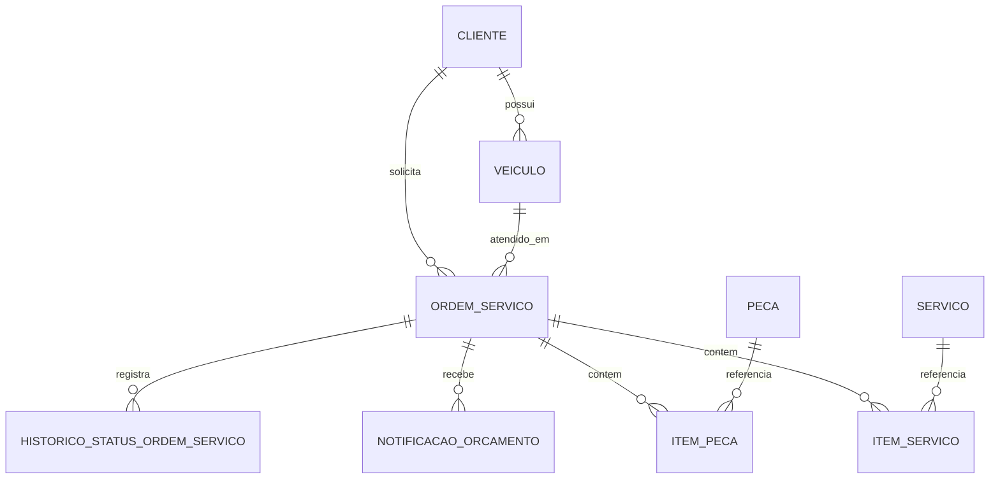

# Modelo relacional — Oficina

O PostgreSQL foi escolhido porque o ciclo de vida de uma OS exige transações e integridade referencial entre cliente, veículo, itens, peças e notificações. RDS fornece a implementação gerenciada; não é substituído pelo PostgreSQL local do Compose.

`cliente.cpf_cnpj` é único; `usuario.username` também. `notificacao_orcamento.identificador_externo` é único para idempotência. `historico_status_ordem_servico` guarda `status_anterior`, `novo_status`, `data_hora`, `origem` e `correlation_id`, com índice por `(ordem_servico_id, data_hora)`. `ordem_servico` tem índice `(status, data_criacao)` para a fila operacional. Chaves estrangeiras impedem histórico/itens órfãos; a baixa de estoque ocorre na transação de aprovação.

Flyway V1 cria o baseline, V2 acrescenta status do cliente e V3 introduz histórico de OS. Em cloud, a mesma sequência migra separadamente os schemas `oficina_homolog` e `oficina_prod`; `ddl-auto=validate` detecta divergência entre entidades e banco. Migração simultânea de múltiplos pods deve usar lock do Flyway, mas o rollout inicial mantém uma réplica por ambiente.
